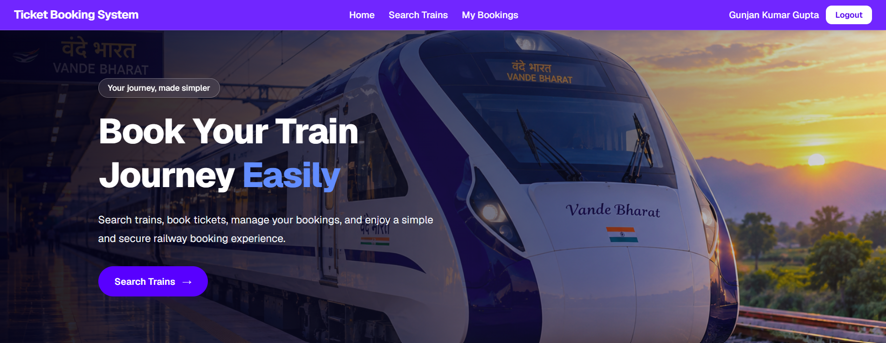
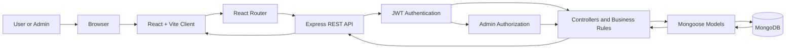
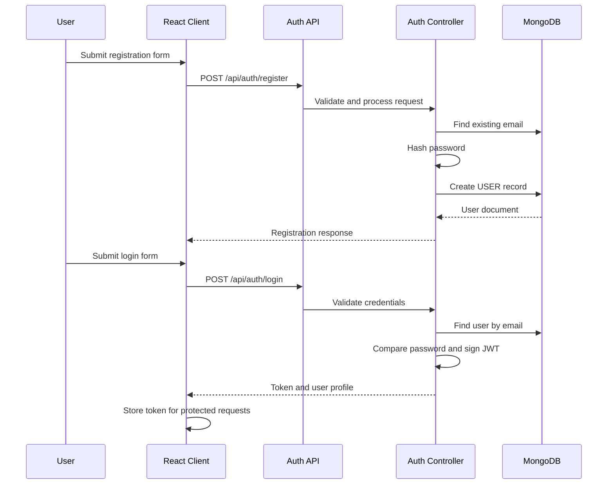
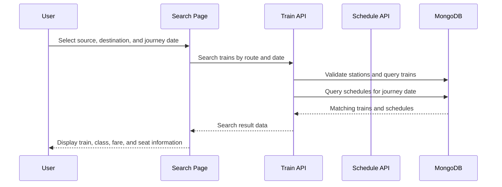
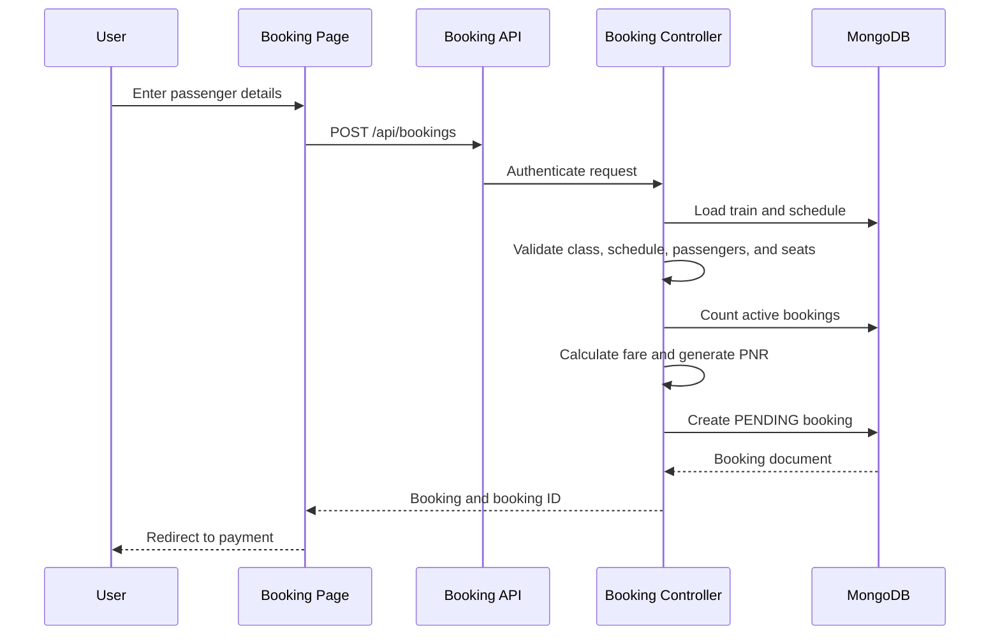
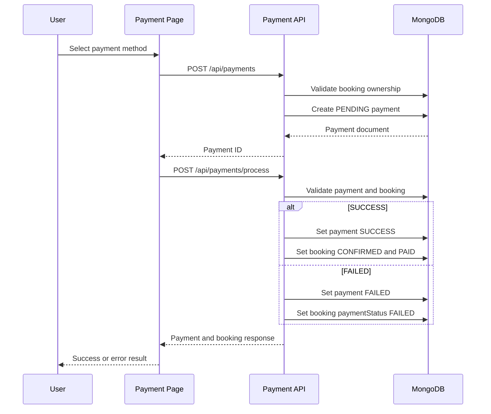
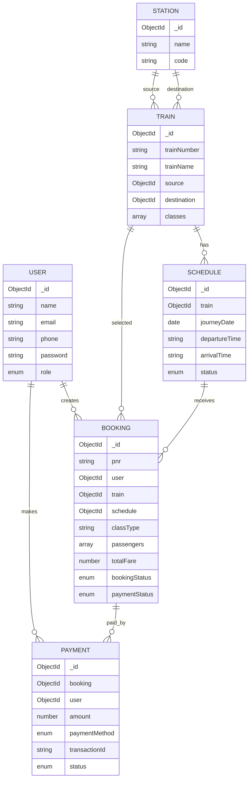

# 🚆 Ticket Booking System

> A full-stack railway ticket booking application built with React, Express,
> MongoDB, and JWT authentication.

The Ticket Booking System allows users to search trains by route and journey
date, review schedules and fare classes, enter passenger details, create a
booking, complete a simulated payment, and manage their bookings. Administrators
can manage trains and schedules, view dashboard statistics, and inspect all
bookings.

This README documents the current repository implementation. It does not
modify or implement the pending functionality described in the roadmap.

---

## Preview



---

## Table of contents

- [Preview](#preview)
- [Project overview](#project-overview)
- [Features](#features)
- [Technology stack](#technology-stack)
- [System architecture](#system-architecture)
- [Project structure](#project-structure)
- [Application flow](#application-flow)
- [Authentication and authorization](#authentication-and-authorization)
- [Domain model](#domain-model)
- [Booking and payment lifecycle](#booking-and-payment-lifecycle)
- [API reference](#api-reference)
- [Frontend routes](#frontend-routes)
- [Installation and local setup](#installation-and-local-setup)
- [Environment variables](#environment-variables)
- [Available scripts](#available-scripts)
- [Implementation status](#implementation-status)
- [Known limitations and roadmap](#known-limitations-and-roadmap)
- [Verification checklist](#verification-checklist)
- [Important notes](#important-notes)

---

## Project overview

The project follows a three-layer MERN architecture:

1. **React/Vite client** — user interface, navigation, forms, protected
   screens, search results, booking, payment, and admin pages.
2. **Express REST API** — routing, authentication middleware, authorization,
   request validation, business rules, and response handling.
3. **MongoDB with Mongoose** — persistent storage for users, stations, trains,
   schedules, bookings, and payments.

### High-level architecture



### Backend request pipeline

```text
HTTP request
    ↓
Express application
    ↓
Route prefix
    ↓
Authentication middleware, when required
    ↓
Admin middleware, for admin endpoints
    ↓
Controller
    ↓
Input validation and business rules
    ↓
Mongoose model
    ↓
MongoDB
    ↓
JSON response
```

---

## Features

### User functionality

- User registration and login
- Password hashing with bcrypt
- JWT-based authentication
- Current-user lookup
- Public station browsing
- Source and destination selection
- Train search by source, destination, and journey date
- Search result display with:
  - Train name and number
  - Source and destination
  - Journey date
  - Departure and arrival time
  - Travel class
  - Fare
  - Seat information
- Passenger details form
- Booking creation
- Simulated payment methods:
  - UPI
  - Card
  - Net banking
- Booking confirmation with PNR
- My Bookings screen
- Individual booking details
- Booking cancellation
- Ownership protection for booking and payment records

### Administrator functionality

- Admin-only dashboard
- Dashboard statistics for users, trains, schedules, bookings, and payments
- Create trains
- Update trains
- Delete trains
- Create schedules
- Update schedules
- Delete schedules
- View all bookings
- Role-based access protection

### Backend functionality

- Express REST API
- MongoDB persistence with Mongoose
- JWT authentication middleware
- Admin role middleware
- ObjectId validation
- Schedule date and time validation
- Passenger validation
- Train class and fare validation
- Duplicate train number protection
- Duplicate train/date schedule protection
- Unique PNR generation
- Unique payment transaction ID generation
- Booking and payment status tracking

---

## Technology stack

### Frontend

| Technology | Purpose |
|---|---|
| React 19 | Component-based user interface |
| Vite | Frontend development server and build tool |
| React Router | Client-side routing |
| Axios | Shared API client and authorization interceptor |
| Tailwind CSS | Utility-first styling |
| Lucide React | Icons |
| Sonner | Toast notifications |
| React Hot Toast | Booking and cancellation notifications |
| Geist | Application font |

### Backend

| Technology | Purpose |
|---|---|
| Node.js | JavaScript runtime |
| Express 5 | HTTP server and REST routing |
| Mongoose | MongoDB object modeling |
| MongoDB | Application database |
| JSON Web Token | Authentication token generation and verification |
| bcrypt/bcryptjs | Password hashing and comparison |
| dotenv | Environment configuration |
| cors | Cross-origin request support |
| Nodemon | Development server restart |

---

## Project structure

```text
ticket-booking-system/
├── README.md
├── .gitignore
│
├── client/
│   ├── package.json
│   ├── index.html
│   ├── vite.config.js
│   ├── eslint.config.js
│   ├── components.json
│   ├── public/
│   │   ├── Vande-Bharat.jpeg
│   │   ├── favicon.svg
│   │   └── icons.svg
│   └── src/
│       ├── App.jsx
│       ├── App.css
│       ├── index.css
│       ├── main.jsx
│       ├── api/
│       │   ├── AdminApi.js
│       │   ├── AuthApi.js
│       │   ├── BookingApi.js
│       │   ├── StationApi.js
│       │   ├── TrainApi.js
│       │   └── axios.js
│       ├── assets/
│       ├── components/
│       │   ├── BookingCard.jsx
│       │   ├── Navbar.jsx
│       │   └── ui/
│       ├── context/
│       │   └── AuthContext.jsx
│       ├── layouts/
│       │   └── MainLayout.jsx
│       ├── lib/
│       ├── pages/
│       │   ├── HomePage.jsx
│       │   ├── LoginPage.jsx
│       │   ├── SignupPage.jsx
│       │   ├── SearchPage.jsx
│       │   ├── SearchResultsPage.jsx
│       │   ├── TrainDetailsPage.jsx
│       │   ├── BookingPage.jsx
│       │   ├── PaymentPage.jsx
│       │   ├── MyBookingsPage.jsx
│       │   ├── BookingDetailsPage.jsx
│       │   └── admin/
│       └── routes/
│           ├── AppRoutes.jsx
│           ├── ProtectedRoute.jsx
│           └── AdminRoute.jsx
│
└── server/
    ├── server.js
    ├── package.json
    ├── config/
    │   └── db.js
    ├── controllers/
    │   ├── adminController.js
    │   ├── authController.js
    │   ├── bookingController.js
    │   ├── paymentController.js
    │   ├── scheduleController.js
    │   ├── stationController.js
    │   └── trainController.js
    ├── middleware/
    │   ├── adminMiddleware.js
    │   └── authMiddleware.js
    ├── models/
    │   ├── User.js
    │   ├── Station.js
    │   ├── Train.js
    │   ├── Schedule.js
    │   ├── Booking.js
    │   └── Payment.js
    ├── routes/
    │   ├── authRoutes.js
    │   ├── stationRoutes.js
    │   ├── trainRoutes.js
    │   ├── scheduleRoutes.js
    │   ├── bookingRoutes.js
    │   ├── paymentRoutes.js
    │   └── adminRoutes.js
    └── utils/
```

The `node_modules` directories are generated dependencies and are not
application source.

---

## Application flow

### 1. Authentication flow



### 2. Train search flow



### 3. Booking flow



### 4. Payment flow



---

## Authentication and authorization

### Roles

| Role | Access |
|---|---|
| `USER` | Search, create bookings, view own bookings, make payments, cancel own bookings |
| `ADMIN` | Admin dashboard, train management, schedule management, and all-booking access |

New registrations receive the default `USER` role. The role is not accepted
from the public registration request.

### Request authentication

Protected API requests use a JWT in the authorization header:

```http
Authorization: Bearer <jwt-token>
```

The authentication middleware:

1. Reads the authorization header.
2. Extracts and verifies the JWT using `JWT_SECRET`.
3. Loads the corresponding user from MongoDB.
4. Assigns the user document to `req.user`.
5. Rejects missing, invalid, expired, or unknown-user tokens.

Admin routes then run `adminMiddleware`, which requires `req.user.role` to be
`ADMIN`.

### Typical authorization responses

| Situation | Response |
|---|---|
| Missing token | `401 Unauthorized` |
| Invalid or expired token | `401 Unauthorized` |
| User does not exist | `401 Unauthorized` |
| Non-admin accessing admin route | `403 Forbidden` |
| User accessing another user’s booking/payment | `403 Forbidden` |

---

## Domain model



### Entity details

#### User

- `name`
- `email`
- hashed `password`
- `phone`
- `role`: `USER` or `ADMIN`

#### Station

- Station `name`
- Station `code`
- Used by trains as source and destination references

#### Train

- `trainNumber`
- `trainName`
- Source station reference
- Destination station reference
- One or more travel classes
- Each class stores:
  - `classType`
  - `fare`
  - `totalSeats`

#### Schedule

- Train reference
- Journey date
- Departure time in `HH:mm` format
- Arrival time in `HH:mm` format
- `status`: `AVAILABLE` or `CANCELLED`
- Unique train/date index to prevent duplicate schedules

#### Booking

- Unique PNR
- User, train, and schedule references
- Selected class
- Passenger array
- Calculated total fare
- `bookingStatus`: `PENDING`, `CONFIRMED`, or `CANCELLED`
- `paymentStatus`: `PENDING`, `PAID`, or `FAILED`

#### Payment

- Booking and user references
- Amount copied from the booking fare
- `paymentMethod`: `CARD`, `UPI`, or `NET_BANKING`
- Unique transaction ID
- `status`: `PENDING`, `SUCCESS`, or `FAILED`

---

## Booking and payment lifecycle

### Booking status

```text
PENDING ── successful payment ──> CONFIRMED
PENDING ── cancellation ─────────> CANCELLED
```

### Payment status

```text
PENDING ── successful processing ──> SUCCESS
PENDING ── failed processing ──────> FAILED
```

### Current seat calculation

Before creating a booking, the backend:

1. Finds all bookings for the selected schedule and class.
2. Excludes bookings whose `bookingStatus` is `CANCELLED`.
3. Adds the passenger count from the remaining bookings.
4. Calculates:

```text
available seats = class totalSeats - booked passenger count
```

5. Rejects the request when the requested passenger count is greater than the
   calculated availability.

This is currently a calculated availability check. It does not yet perform an
atomic inventory reservation or mutate a dedicated available-seat counter.

---

## API reference

### Base URLs

| Environment | URL |
|---|---|
| Backend default | `http://localhost:5001` |
| Frontend configured API base | `http://localhost:5000/api` |

The frontend and backend must be configured to use the same API port for the
complete local flow. No source code or configuration is changed by this README.

### Health check

| Method | Endpoint | Auth | Description |
|---|---|---|---|
| `GET` | `/` | Public | Returns the API health message |

### Authentication endpoints

Base path: `/api/auth`

| Method | Endpoint | Auth | Description |
|---|---|---|---|
| `POST` | `/register` | Public | Register a new user |
| `POST` | `/login` | Public | Authenticate a user and return a JWT |
| `GET` | `/me` | JWT | Return the current authenticated user |

Protected requests use the following header:

```http
Authorization: Bearer <jwt-token>
```

### Station endpoints

Base path: `/api/stations`

| Method | Endpoint | Description |
|---|---|---|
| `POST` | `/` | Create a station |
| `GET` | `/` | Fetch stations |
| `GET` | `/:id` | Fetch one station |
| `PUT` | `/:id` | Update a station |
| `DELETE` | `/:id` | Delete a station |

### Train endpoints

Base path: `/api/trains`

| Method | Endpoint | Description |
|---|---|---|
| `POST` | `/` | Create a train |
| `GET` | `/?source=<id>&destination=<id>` | Fetch trains for a route |
| `GET` | `/search?source=<id>&destination=<id>&journeyDate=<date>` | Search trains for a journey |
| `GET` | `/:id` | Fetch one train |
| `PUT` | `/:id` | Update a train |
| `DELETE` | `/:id` | Delete a train |

The search endpoint first matches trains by source and destination, then
returns only schedules with `status: "AVAILABLE"` for the requested journey
date. Its successful response uses `results`, where each item contains a
populated `train` and a schedule summary with `_id`, `journeyDate`,
`departureTime`, `arrivalTime`, and `status`. No matching trains or schedules
returns `404`.

### Schedule endpoints

Base path: `/api/schedules`

| Method | Endpoint | Description |
|---|---|---|
| `POST` | `/` | Create a schedule |
| `GET` | `/?journeyDate=<date>` | Fetch schedules for a date |
| `GET` | `/:id` | Fetch one schedule |
| `PUT` | `/:id` | Update a schedule |
| `DELETE` | `/:id` | Delete a schedule |

### Booking endpoints

Base path: `/api/bookings`

All booking endpoints require JWT authentication.

| Method | Endpoint | Description |
|---|---|---|
| `POST` | `/` | Create a booking |
| `GET` | `/` | Fetch the logged-in user’s bookings |
| `GET` | `/:id` | Fetch one owned booking |
| `DELETE` | `/:id` | Cancel one owned booking |

Example booking request:

```json
{
  "trainId": "TRAIN_OBJECT_ID",
  "scheduleId": "SCHEDULE_OBJECT_ID",
  "classType": "AC1",
  "passengers": [
    {
      "name": "Passenger Name",
      "age": 28,
      "gender": "OTHER"
    }
  ]
}
```

### Payment endpoints

Base path: `/api/payments`

All payment endpoints require JWT authentication.

| Method | Endpoint | Description |
|---|---|---|
| `POST` | `/` | Initiate a payment for an owned booking |
| `POST` | `/process` | Process a simulated `SUCCESS` or `FAILED` result |
| `GET` | `/` | Fetch the logged-in user’s payments |
| `GET` | `/:paymentId` | Fetch one owned payment |

Example payment initiation request:

```json
{
  "bookingId": "BOOKING_OBJECT_ID",
  "paymentMethod": "UPI"
}
```

Example simulated processing request:

```json
{
  "paymentId": "PAYMENT_OBJECT_ID",
  "result": "SUCCESS"
}
```

### Admin endpoints

Base path: `/api/admin`

All admin endpoints require a valid JWT and the `ADMIN` role.

| Method | Endpoint | Description |
|---|---|---|
| `GET` | `/test` | Verify admin access |
| `GET` | `/dashboard` | Fetch dashboard statistics |
| `GET` | `/trains` | Fetch all trains for administration |
| `POST` | `/trains` | Create a train |
| `PUT` | `/trains/:id` | Update a train |
| `DELETE` | `/trains/:id` | Delete a train |
| `POST` | `/schedules` | Create a schedule |
| `PUT` | `/schedules/:id` | Update a schedule |
| `DELETE` | `/schedules/:id` | Delete a schedule |
| `GET` | `/bookings` | Fetch all bookings |

---

## Frontend routes

### Public routes

| Path | Screen |
|---|---|
| `/` | Home page |
| `/login` | Login |
| `/signup` | Signup |
| `/search` | Train search |
| `/search/results` | Search results |
| `/trains/:trainId` | Train details |
| `/booking` | Passenger and booking form |
| `/payment` | Payment page |

### Protected user routes

| Path | Screen |
|---|---|
| `/my-bookings` | Logged-in user’s bookings |
| `/my-bookings/:id` | Booking details |

### Protected admin routes

| Path | Screen |
|---|---|
| `/admin/dashboard` | Dashboard |
| `/admin/trains/add` | Add train |
| `/admin/trains` | Manage trains |
| `/admin/schedules/create` | Create schedule |

`ProtectedRoute` protects authenticated user screens. `AdminRoute` protects
admin screens based on the authenticated user role.

---

## Installation and local setup

### Prerequisites

- Node.js and npm
- MongoDB instance, local or hosted
- A configured MongoDB connection string

### 1. Clone and enter the project

```bash
git clone <repository-url>
cd ticket-booking-system
```

### 2. Install backend dependencies

```bash
cd server
npm install
```

### 3. Configure backend environment

Create `server/.env` using the variables described below.

### 4. Start the backend

Development mode:

```bash
npm run dev
```

Production-style start:

```bash
npm start
```

The backend defaults to port `5001`.

### 5. Install frontend dependencies

Open a second terminal:

```bash
cd client
npm install
```

### 6. Start the frontend

```bash
npm run dev
```

Vite prints the local frontend URL in the terminal.

### 7. Verify the backend

```bash
curl http://localhost:5001/
```

Expected response:

```text
TICKET BOOKING SYSTEM API IS RUNNING...
```

---

## Environment variables

Create `server/.env`:

```env
MONGO_URI=mongodb://127.0.0.1:27017/ticket-booking-system
JWT_SECRET=replace-with-a-long-random-secret
PORT=5001
```

| Variable | Required | Description |
|---|---:|---|
| `MONGO_URI` | Yes | MongoDB connection string |
| `JWT_SECRET` | Yes | Secret used to sign and verify JWTs |
| `PORT` | No | Backend port; defaults to `5001` |

Do not commit `.env` files, passwords, database credentials, or JWT secrets.

---

## Available scripts

### Client scripts

Run from `client/`:

| Command | Description |
|---|---|
| `npm run dev` | Start the Vite development server |
| `npm run build` | Generate a production build |
| `npm run lint` | Run ESLint |
| `npm run preview` | Preview the production build |

### Server scripts

Run from `server/`:

| Command | Description |
|---|---|
| `npm start` | Start `node server.js` |
| `npm run dev` | Start the server with Nodemon |
| `npm test` | Placeholder script; automated tests are not configured |

---

## Implementation status

The following functionality is implemented and verified in the current
repository:

| # | Module | Status |
|---:|---|---|
| 1 | Express server, MongoDB connection, and environment configuration | Complete |
| 2 | User signup and login | Verified |
| 3 | `USER` and `ADMIN` role-based protection | Verified |
| 4 | Station fetching and source/destination selection | Verified |
| 5 | Admin train create, update, and delete | Verified |
| 6 | Admin schedule create, update, and delete | Verified |
| 7 | Train search by journey date and stations | Verified |
| 8 | Search result details, fare, class, timing, and seat information | Verified |
| 9 | Passenger and journey booking flow | Verified |
| 10 | UPI, card, and net-banking simulated payment success flow | Verified |
| 11 | Booking and payment database persistence | Verified |
| 12 | Logged-in user booking display | Verified |
| 13 | Booking ownership protection with `403` response | Verified |
| 14 | Admin dashboard API protection | Verified |
| 15 | Admin all-bookings retrieval | Verified |

---

## Known limitations and roadmap

These items are not fully complete and should be addressed before production
deployment.

| Priority | Area | Current state and required improvement |
|---|---|---|
| High | Seat inventory | Available seats are calculated from active bookings; a dedicated seat counter is not decremented after successful booking. |
| High | Cancellation | Cancellation changes the booking status but does not explicitly restore a stored seat inventory value. |
| High | Zero-seat protection | The current pre-check rejects insufficient availability, but concurrent requests can still race because reservation is not atomic. |
| High | Payment failure lifecycle | Failed payments update payment status to `FAILED`, while the booking remains non-cancelled. A final booking lifecycle policy is required. |
| High | Transaction consistency | Booking creation, payment creation, payment processing, and status updates are not coordinated by a shared MongoDB transaction. |
| High | Schedule lifecycle | Search excludes cancelled schedules and booking creation rejects unavailable schedules, but schedule cancellation does not yet define a complete policy for existing bookings. |
| High | Concurrency safety | Separate availability calculation and booking creation can theoretically oversell seats under concurrent requests. |
| Medium | Input validation | Basic validation exists, but field lengths, age limits, numeric bounds, duplicate class types, and complete request schemas need strengthening. |
| Medium | Frontend error UX | Some flows use browser alerts and console logging; API errors should be presented consistently using shared UI notifications. |
| Medium | Automated tests | The server test command is a placeholder and no automated regression suite is configured. |
| Medium | Error middleware | Controller errors passed to `next(error)` rely on Express’s default error handling because no application-level error handler is registered. |
| Medium | API protection consistency | Station and public train/schedule mutation routes exist in addition to admin-protected routes; production deployment should define and enforce the intended ownership policy. |
| Low | Configuration | Frontend API configuration currently points to port `5000`, while the backend default is `5001`; these values must be aligned for local integration. |

---

## Verification checklist

### Authentication

- [x] User can register
- [x] User can log in
- [x] JWT is returned after login
- [x] Protected requests require authentication
- [x] Invalid tokens are rejected
- [x] Admin routes reject normal users

### Search and schedules

- [x] Stations can be fetched
- [x] Source and destination can be selected
- [x] Same source and destination are rejected
- [x] Journey date is validated
- [x] Train search returns route-compatible results
- [x] Schedule time format is validated
- [x] Duplicate train/date schedules are rejected

### Booking

- [x] Train and schedule references are validated
- [x] Selected class is validated
- [x] Passenger details are validated
- [x] Fare is calculated from class fare and passenger count
- [x] Seat availability is checked before booking
- [x] Unique PNR is generated
- [x] Users can view their own bookings
- [x] Users cannot view another user’s booking
- [x] Users can cancel their own booking

### Payment

- [x] Payment method is validated
- [x] Payment ownership is checked
- [x] Payment amount is compared with booking fare
- [x] Duplicate successful payment is rejected
- [x] Successful payment confirms the booking
- [x] Failed payment is persisted

### Administration

- [x] Admin dashboard is protected
- [x] Admin train management is protected
- [x] Admin schedule management is protected
- [x] Admin can fetch all bookings

---

## Important notes

1. This project uses a **simulated payment processor**. It does not connect to
   a real UPI, card, bank, or payment gateway provider.
2. MongoDB must be available for authentication, search, booking, payment, and
   administration flows.
3. The frontend and backend API ports must match. The current frontend API
   configuration uses `http://localhost:5000/api`; the backend defaults to
   `http://localhost:5001`.
4. Never expose `MONGO_URI`, `JWT_SECRET`, or other secrets in source control.
5. The project currently has no configured automated test suite.
6. This documentation describes the current implementation only. It does not
   automatically change code, configuration, database schema, or behavior.

---