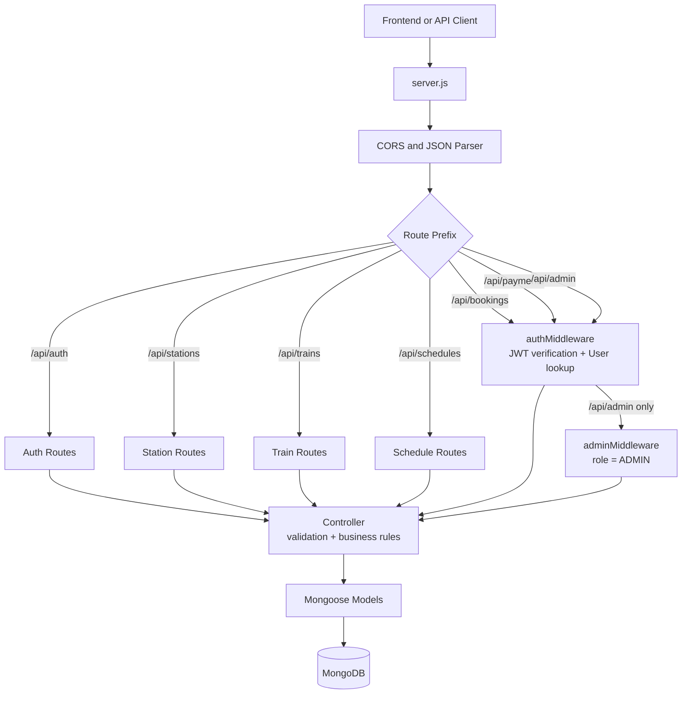
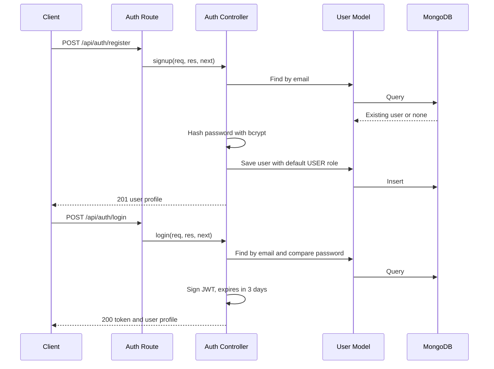
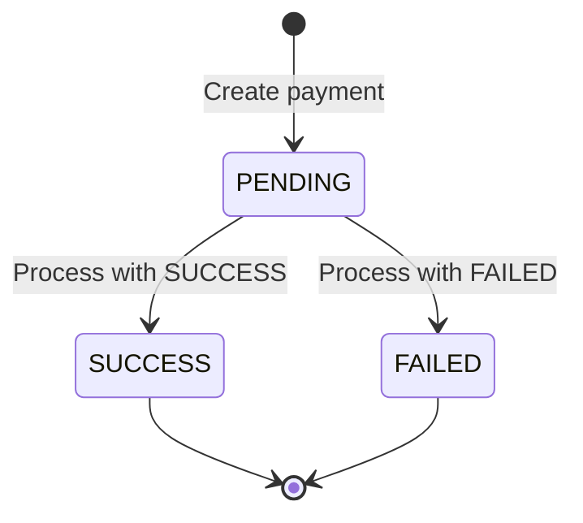
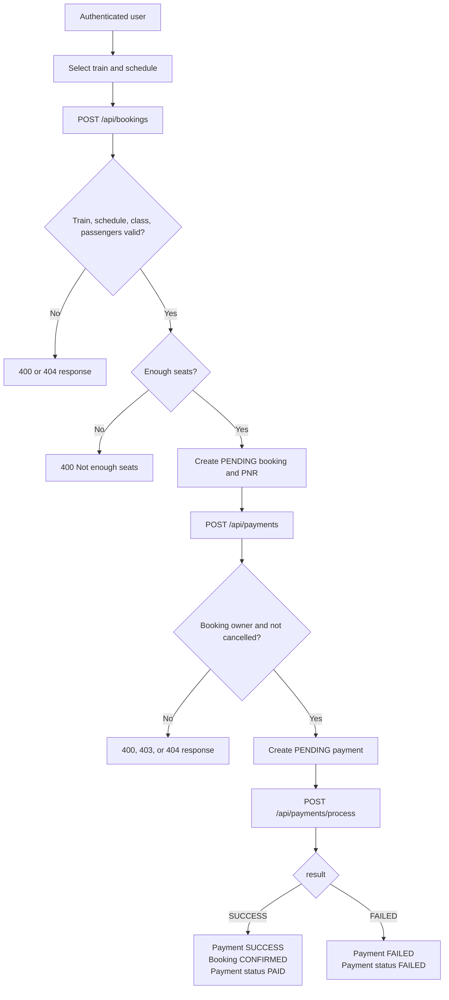
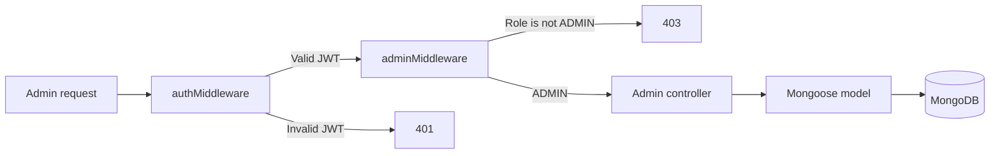
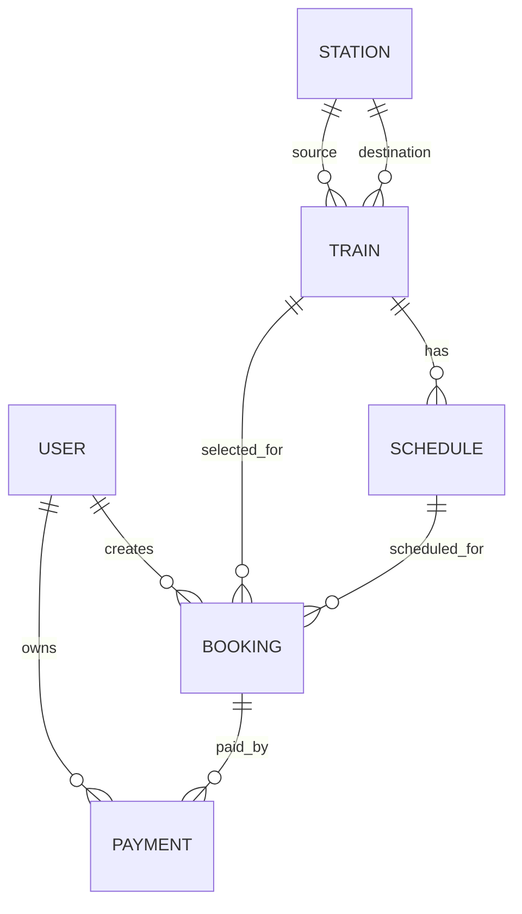

# Ticket Booking System Backend

> Backend reference for the railway ticket booking application.

This document describes the backend as implemented in the repository. It is
documentation only and does not change application code, routes, models, or
database behavior.

## 1. Overview

The `server` folder contains a Node.js and Express REST API for a railway ticket booking system. It provides:

- User registration, login, and JWT-based authentication.
- Station, train, and schedule management.
- Authenticated booking and cancellation workflows.
- Simulated payment initiation and processing.
- Admin dashboard statistics and protected administrative operations.
- MongoDB persistence through Mongoose.

The backend is organized using a conventional Express layered structure:

`client/API consumer -> routes -> middleware -> controllers -> models -> MongoDB`

Authentication and authorization are applied in the route layer through middleware before protected controllers are executed.

## 2. Folder Structure

```text
server/
├── server.js                         Application entry point
├── package.json                      Scripts and dependency declarations
├── package-lock.json                 Locked dependency versions
├── .env                              Local secrets/configuration; ignored by Git
├── .gitignore                        Ignored files and folders
├── config/
│   └── db.js                         Mongoose database connection helper
├── controllers/
│   ├── adminController.js             Admin dashboard and admin operations
│   ├── authController.js              Registration, login, current-user logic
│   ├── bookingController.js           Booking creation, retrieval, cancellation
│   ├── paymentController.js           Payment creation, processing, retrieval
│   ├── scheduleController.js          Schedule CRUD and validation
│   ├── stationController.js           Station CRUD and validation
│   └── trainController.js              Train CRUD and search validation
├── middleware/
│   ├── adminMiddleware.js              ADMIN role authorization
│   └── authMiddleware.js               JWT authentication and user loading
├── models/
│   ├── Booking.js                     Booking schema and status fields
│   ├── Payment.js                     Payment schema and status fields
│   ├── Schedule.js                    Train schedule schema and unique index
│   ├── Station.js                     Station schema
│   ├── Train.js                       Train schema and class pricing
│   └── User.js                        User schema and roles
├── routes/
│   ├── adminRoutes.js                 Protected admin endpoints
│   ├── authRoutes.js                  Authentication endpoints
│   ├── bookingRoutes.js               User booking endpoints
│   ├── paymentRoutes.js               User payment endpoints
│   ├── scheduleRoutes.js              Schedule endpoints
│   ├── stationRoutes.js               Station endpoints
│   └── trainRoutes.js                 Train endpoints
├── utils/                             Currently empty
└── node_modules/                      Installed npm dependencies; generated/local
```

`node_modules` is an installed dependency directory and is not application source. `.env` is also local configuration and must not be committed or exposed.

## 3. Architecture



### Request processing sequence

1. `server.js` loads environment variables with `dotenv`.
2. Express enables unrestricted CORS and JSON body parsing.
3. A request is dispatched to the matching route prefix.
4. Protected routes run `authMiddleware` before the controller.
5. Admin routes run `adminMiddleware` after authentication.
6. The controller validates input, applies business rules, and calls Mongoose models.
7. Mongoose reads or writes MongoDB.
8. The controller returns a JSON response. Controller errors passed to `next(error)` rely on Express's default error handler because no application-level error handler is registered.

## 4. Application Startup

`server.js` performs the following startup actions:

1. Imports Express, CORS, dotenv, route modules, and the database helper.
2. Calls `dotenv.config()`.
3. Creates the Express application.
4. Registers `cors()` and `express.json()`.
5. Mounts all route modules.
6. Calls `connectDB()` using `MONGO_URI`.
7. Exposes `GET /` as a basic health response.
8. Starts listening on `PORT`, or port `5001` when `PORT` is not set.

### Environment variables

| Variable | Purpose | Required |
|---|---|---:|
| `MONGO_URI` | MongoDB connection string | Yes |
| `JWT_SECRET` | Secret used to sign and verify JWTs | Yes |
| `PORT` | HTTP port; defaults to `5001` | No |

Database connection failures are logged, but the process still proceeds to listen for HTTP requests. The application therefore can start even when MongoDB is unavailable.

### NPM commands

| Command | Behavior |
|---|---|
| `npm start` | Starts `node server.js` |
| `npm run dev` | Starts the server with Nodemon |
| `npm test` | Placeholder script; no tests are configured |

## 5. Authentication and Authorization

### Registration and login flow



`authMiddleware` expects an authorization value containing a token after a space, normally:

```http
Authorization: Bearer <jwt>
```

It verifies the token using `JWT_SECRET`, loads the user from MongoDB using the token's `id`, and assigns the user document to `req.user`.

| Condition | Response |
|---|---|
| Authorization header missing | `401 { message: "Authorization token required" }` |
| Token segment missing | `401 { message: "Invalid authorization format" }` |
| User no longer exists | `401 { message: "User not found" }` |
| Invalid or expired JWT | `401 { message: "Invalid or expired token" }` |
| Authenticated user is not an admin | `403 { message: "Admin access required." }` |

Registration does not accept a role from the request body. New users receive the model default `USER` role.

## 6. API Reference

Base URL for local development: `http://localhost:5001`

### Health endpoint

| Method | Path | Auth | Description |
|---|---|---|---|
| GET | `/` | None | Returns `TICKET BOOKING SYSTEM API IS RUNNING...` as plain text. |

### Authentication: `/api/auth`

| Method | Path | Auth | Request body | Success |
|---|---|---|---|---|
| POST | `/register` | None | `name`, `email`, `phone`, `password` | `201` with `message` and public user fields |
| POST | `/login` | None | `email`, `password` | `200` with `message`, JWT `token`, and user |
| GET | `/me` | User | None | `200` with the authenticated user |

Duplicate email registration returns `409`. Invalid login credentials return `401`.

### Stations: `/api/stations`

| Method | Path | Auth | Request | Success |
|---|---|---|---|---|
| POST | `/` | None | Body: `name`, `code`, `city`, `state` | `201 { message, station }` |
| GET | `/` | None | None | `200 { message, stations }` |
| GET | `/:id` | None | Station ObjectId | `200 { message, station }` |
| PUT | `/:id` | None | Full body: `name`, `code`, `city`, `state` | `200 { message, updatedStation }` |
| DELETE | `/:id` | None | Station ObjectId | `200 { message, station }` |

Station codes are unique. Update and delete validate the ObjectId; the single-station read does not explicitly prevalidate it.

### Trains: `/api/trains`

| Method | Path | Auth | Request | Success |
|---|---|---|---|---|
| POST | `/` | None | `trainNumber`, `trainName`, `source`, `destination`, non-empty `classes[]` | `201 { message, train }` |
| GET | `/` | None | Query: required `source`, `destination` station IDs | `200 { message, trains }` |
| GET | `/search` | None | Query: required `source`, `destination`, `journeyDate` | `200 { message, results }` |
| GET | `/:id` | None | Train ObjectId | `200 { message, train }` with stations populated |
| PUT | `/:id` | None | Full train body | `200 { message, train }` |
| DELETE | `/:id` | None | Train ObjectId | `200 { message, train }` |

Train creation and updates reject invalid station IDs, missing stations,
identical source/destination stations, and duplicate train numbers. A search
with no matching trains or schedules returns `404`.

The `/search` endpoint first finds trains matching the route, then returns only
`AVAILABLE` schedules for the requested date. Each result contains a populated
`train` and a schedule summary with its ID, journey date, departure time,
arrival time, and status.

Each class has the shape:

```json
{
  "classType": "AC",
  "fare": 500,
  "totalSeats": 60
}
```

### Schedules: `/api/schedules`

| Method | Path | Auth | Request | Success |
|---|---|---|---|---|
| POST | `/` | None | `train`, `journeyDate`, `departureTime`, `arrivalTime` | `201 { message, schedule }` |
| GET | `/` | None | Query: required `journeyDate` | `200 { message, schedules }` with train populated |
| GET | `/:id` | None | Schedule ObjectId | `200 { message, schedule }` with train populated |
| PUT | `/:id` | None | Optional: `journeyDate`, `departureTime`, `arrivalTime`, `status` | `200 { message, schedule }` |
| DELETE | `/:id` | None | Schedule ObjectId | `200 { message, schedule }` |

Times must use 24-hour `HH:mm` format. Status values are `AVAILABLE` and `CANCELLED`. There can be only one schedule for a train on a given journey date. Date searches cover local midnight through local `23:59:59.999` on the server.

### Bookings: `/api/bookings`

All booking endpoints require an authenticated user.

| Method | Path | Auth | Request | Success |
|---|---|---|---|---|
| POST | `/` | User | `trainId`, `scheduleId`, `classType`, `passengers[]` | `201 { message, booking }` |
| GET | `/` | User | None | `200 { message, bookings }` with train and schedule populated |
| GET | `/:id` | Booking owner | Booking ObjectId | `200 { message, booking }` |
| DELETE | `/:id` | Booking owner | Booking ObjectId | `200 { message, booking }`; sets status to `CANCELLED` |

Passenger objects require `name`, a positive `age`, and `gender` equal to `MALE`, `FEMALE`, or `OTHER`.

Booking creation verifies that:

- The train and schedule exist.
- The schedule belongs to the selected train.
- The schedule is `AVAILABLE`.
- The selected class exists on the train.
- Enough seats remain after excluding cancelled bookings.

The fare is calculated as `class fare * passenger count`. A unique random numeric PNR is generated. New bookings start with `bookingStatus: PENDING` and `paymentStatus: PENDING`.

### Payments: `/api/payments`

All payment endpoints require an authenticated user and enforce ownership.

| Method | Path | Auth | Request | Success |
|---|---|---|---|---|
| POST | `/` | User | `bookingId`, `paymentMethod` | `201 { message, payment }` |
| POST | `/process` | Payment owner | `paymentId`, `result` | `200 { message, payment, booking }` |
| GET | `/` | User | None | `200 { message, payments }` with booking populated |
| GET | `/:paymentId` | Payment owner | Payment ObjectId | `200 { message, payment }` with booking populated |

Allowed payment methods are `CARD`, `UPI`, and `NET_BANKING`. Allowed processing results are `SUCCESS` and `FAILED`.

Payment state transitions:



On successful processing, the payment becomes `SUCCESS`, the booking becomes `CONFIRMED`, and its payment status becomes `PAID`. On failure, the payment becomes `FAILED` and the booking payment status becomes `FAILED`.

### Admin: `/api/admin`

Every admin endpoint requires both a valid JWT and `role: ADMIN`.

| Method | Path | Request | Success |
|---|---|---|---|
| GET | `/test` | None | `200 { message: "Admin access granted." }` |
| GET | `/dashboard` | None | `200 { message, data }` with five document counts |
| POST | `/trains` | `trainNumber`, `trainName`, `source`, `destination`, `classes` | `201 { message, train }` |
| PUT | `/trains/:id` | Optional train fields | `200 { message, train }` |
| DELETE | `/trains/:id` | Train ObjectId | `200 { message, train }` |
| POST | `/schedules` | `train`, `journeyDate`, `departureTime`, `arrivalTime` | `201 { message, schedule }` |
| PUT | `/schedules/:id` | Optional schedule fields | `200 { message, schedule }` |
| DELETE | `/schedules/:id` | Schedule ObjectId | `200 { message, schedule }` |
| GET | `/bookings` | Optional `status` query | `200 { message, bookings }` with user, train, schedule populated |

The dashboard returns `totalUsers`, `totalTrains`, `totalSchedules`, `totalBookings`, and `totalPayments`. The booking status filter accepts `PENDING`, `CONFIRMED`, or `CANCELLED`.

## 7. Core Business Flows

### Booking and payment flow



### Admin request flow



## 8. Data Model

All models use Mongoose timestamps, which add `createdAt` and `updatedAt`.

| Model | Important fields | Relationships and constraints |
|---|---|---|
| `User` | `name`, `email`, `password`, `phone`, `role` | Unique email; role is `USER` or `ADMIN`; default `USER` |
| `Station` | `name`, `code`, `city`, `state` | Unique station code |
| `Train` | `trainNumber`, `trainName`, `source`, `destination`, `classes[]` | Source/destination reference `Station`; unique train number |
| `Schedule` | `train`, `journeyDate`, `departureTime`, `arrivalTime`, `status` | References `Train`; unique compound index on `train + journeyDate` |
| `Booking` | `pnr`, `user`, `train`, `schedule`, `classType`, `passengers[]`, `totalFare`, statuses | References `User`, `Train`, and `Schedule`; unique PNR |
| `Payment` | `booking`, `user`, `amount`, `paymentMethod`, `transactionId`, `status` | References `Booking` and `User`; unique transaction ID |



## 9. File Responsibilities

### `server.js`

Owns application composition, global middleware, route mounting, database initialization, the root health endpoint, and the HTTP listener.

### `config/db.js`

Exports `connectDB`, an asynchronous helper that calls `mongoose.connect(process.env.MONGO_URI)` and logs connection failures.

### Route modules

Route files define URL paths, HTTP methods, middleware order, and controller bindings. They contain little business logic. `adminRoutes.js` also reuses schedule controller functions for admin schedule management.

### Controller modules

- `authController.js`: bcrypt password hashing/comparison, JWT creation, and user response shaping.
- `stationController.js`: station CRUD, duplicate-code checks, and ObjectId validation for writes.
- `trainController.js`: station validation, train uniqueness, train search, and class data handling.
- `scheduleController.js`: train existence, date/time validation, duplicate schedule prevention, and status updates.
- `bookingController.js`: booking ownership, seat calculation, passenger validation, fare calculation, and cancellation.
- `paymentController.js`: payment ownership, transaction ID generation, payment state changes, and booking synchronization.
- `adminController.js`: aggregate document counts, admin train operations, and filtered booking retrieval.

### Middleware modules

- `authMiddleware.js` establishes `req.user` from a verified JWT.
- `adminMiddleware.js` permits only users whose role is exactly `ADMIN`.

### Model modules

Model files define MongoDB document shape, required fields, enums, references, uniqueness, defaults, timestamps, and the schedule compound index.

### `utils/`

The directory currently contains no files or helper implementations.

### `package-lock.json` and `node_modules/`

`package-lock.json` records the resolved dependency tree. `node_modules/` contains the installed packages and is generated from the package manifests; neither contains business logic maintained by this application.

## 10. Current Implementation Notes

The following describes the current backend behavior and should be considered when integrating or operating it:

- Station, train, and schedule mutation endpoints under their public prefixes are unauthenticated. Admin-protected equivalents also exist for trains and schedules.
- Some admin train validation response properties are misspelled (`mesage` and `messge`).
- The admin dashboard error path calls `next(error)` and then attempts another response, which can result in a headers-already-sent error.
- There is no custom application-level error handler, request validation layer, rate limiter, refresh-token flow, or audit log.
- The payment processor accepts a client-provided `SUCCESS` or `FAILED` result and is therefore a simulated payment integration.
- Seat availability is checked before booking creation without a transaction or atomic reservation. Concurrent booking requests can theoretically oversell seats.
- Deleting a train, station, or schedule does not explicitly clean up or protect dependent documents.
- Public train creation/update checks that `classes` is a non-empty array but does not perform the same per-class positivity checks as the admin train creation path.
- CORS is enabled for all origins through `cors()`.
- The dependencies include both `bcrypt` and `bcryptjs`; the controllers use `bcrypt`.
- The client and server currently use different default API ports in the
  repository: the frontend Axios client points to `http://localhost:5000/api`,
  while `server.js` defaults to port `5001`. These values must be aligned for
  local end-to-end integration.

These notes document the repository as it currently exists; they are not implementation changes.

## 11. Recommended Integration Order

For a normal customer booking journey, clients should call APIs in this order:

1. `POST /api/auth/register` or `POST /api/auth/login`.
2. `GET /api/stations` to load station choices.
3. `GET /api/trains/search?source=<stationId>&destination=<stationId>&journeyDate=<date>`
   to retrieve route-compatible available schedules.
4. Select a returned train, schedule, and class.
5. `POST /api/bookings` with the selected train, schedule, class, and
   passengers.
6. `POST /api/payments` for the created booking.
7. `POST /api/payments/process` with the simulated `SUCCESS` or `FAILED`
   result.
8. `GET /api/bookings` or `GET /api/payments` to display the resulting
   records.

For administration, authenticate as an existing `ADMIN` user, then send the JWT on every `/api/admin` request.
